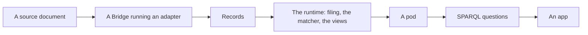

# cascade-runtime-js

The reference runtime, in TypeScript. It files what arrives into a pod and
answers questions from it, in Node or entirely in a browser, and proves itself
against the vocabulary's executable examples.

## Docs

- [The Cascade hub](https://jayostis.github.io/cascade-runtime-js/): where to go for each thing, and every repository.
- [Quick start](https://jayostis.github.io/cascade-runtime-js/start.html): how to start an app on the runtime.
- [API](https://jayostis.github.io/cascade-runtime-js/api/): the API an app calls.
- [Agent guide](https://jayostis.github.io/cascade-runtime-js/AGENTS.md): what a coding agent needs to build on the runtime.
- [Example pods](https://jayostis.github.io/cascade-runtime-js/examples.html): the example pods, with the stories they tell: Alex Rivera's, from Apple Health exports; Priya Natarajan's, from an export and C-CDA downloads together; Martin Okafor's, two FHIR reports of one variant beside what ClinVar says today; and Tamsin Vale's, one demo hospital's FHIR record pulled twice, a year apart, with a medication stopped between the pulls.
- [Conformance](https://jayostis.github.io/cascade-runtime-js/conformance/): the reference runtime's latest result on main for every example of the vocabulary's features and conformance kits.
- [Unit-test report](https://jayostis.github.io/cascade-runtime-js/conformance/tests/cascade-runtime-js/): each case of the runtime's tests, with its result and time, from the newest run on main. Each other Cascade repository has its own page beside it, at `conformance/tests/<repository>/`, listed on the [conformance page](https://jayostis.github.io/cascade-runtime-js/conformance/).
- [Evals](https://jayostis.github.io/cascade-runtime-js/evals/): how the pod, through `cascade-mcp`, does against the same records pasted into a chat, on synthetic people, with every citation checked and every cost.
- [An app running in the browser](https://jayostis.github.io/cascade-starter-kit/try/): try a pod in the browser.
- [The starter kit](https://github.com/jayostis/cascade-starter-kit): the app `create-cascade-app` makes, the command itself, and the page in the browser.

## What the Cascade Protocol is

The Cascade Protocol is an open standard for health apps that put patients in
control of their own data.

- **The patient holds the data.** Each person's records are in their own pod, a
  single-tenant RDF graph kept as Turtle files. Apps come to the pod; the pod
  does not go to the apps.
- **Anyone with an idea can build an app.** One command starts an app,
  and a coding agent can build on it from there.
- **Apps interoperate.** Records arrive from each source format through a Bridge
  running an adapter, so every app reads the same records with the same
  standard SPARQL questions.

It is open source and built on RDF and Turtle, SPARQL 1.1, SHACL, RO-Crate
and EARL reports.
This runtime files two source formats into one pod: FHIR R4, as an Apple Health
export carries it, and C-CDA, as a patient portal hands it out. The same record
from both, an allergy, a medication or a lab result, is joined as one entry. A
pod holds allergies, conditions, immunizations, procedures, medications, lab
results and the patient's profile.

Status: a draft. No compatibility is promised before a numbered v1, and no
claim is made that it is fit for clinical use.

## In this README

- [The protocol's repositories](#the-protocols-repositories)
- [How it fits together](#how-it-fits-together), and [its packages](#packages)
- [Working on this repository](CONTRIBUTING.md#working-on-this-repository): building from
  source, running the tests, the developer stories, the package, and which version of each component a run uses

## The protocol's repositories

| Repository                                                                                   | What it is                                                                                                                                       |
| -------------------------------------------------------------------------------------------- | ------------------------------------------------------------------------------------------------------------------------------------------------ |
| [cascade-vocabulary](https://github.com/jayostis/cascade-vocabulary)                         | The contract a Cascade pod is built and read by: the ontologies and shapes, the standard queries, the runtime rules and the conformance kit.     |
| [cascade-bridge-spec](https://github.com/jayostis/cascade-bridge-spec)                       | The Cascade Bridge Specification: the contract every adapter and every Bridge follows. Draft: no compatibility is promised before a numbered v1. |
| [cascade-bridge-rs](https://github.com/jayostis/cascade-bridge-rs)                           | The Cascade Bridge for Rust, also built for WebAssembly. Draft.                                                                                  |
| [cascade-bridge-js](https://github.com/jayostis/cascade-bridge-js)                           | The Cascade Bridge for JavaScript. Draft.                                                                                                        |
| [cascade-bridge-adapter-fhir-r4](https://github.com/jayostis/cascade-bridge-adapter-fhir-r4) | The adapter for FHIR R4 JSON, alone or in a Bundle. Import-only.                                                                                 |
| [cascade-bridge-adapter-ccda](https://github.com/jayostis/cascade-bridge-adapter-ccda)       | The adapter for C-CDA R2.1 XML, as a patient portal hands it out. Import-only.                                                                   |
| cascade-runtime-js (this repository)                                                         | The reference runtime.                                                                                                                           |

## How it fits together

An adapter is data: mappings, schemas, fixtures and a manifest, with no code. A
Bridge runs it, and there is one Bridge per language.

The core in `packages/runtime/src` knows four interfaces and nothing behind
them. That is how the same runtime runs in Node and in a browser:

| Interface    | What it does                                                            | What plugs in today                             |
| ------------ | ----------------------------------------------------------------------- | ----------------------------------------------- |
| `Files`      | reads and writes bytes, by path or IRI                                  | a local folder, memory, the browser's IndexedDB |
| `Bridge`     | describes and loads an adapter, asks if it accepts a document, converts | cascade-bridge-rs in a worker; saved output     |
| `Store`      | runs SPARQL over named graphs, and reads Turtle as it is written        | Oxigraph's JavaScript build                     |
| `IdsAndTime` | mints the ID of an import or an entry session, and gives the time       | random UUIDs; the clock or the story's times    |

Code that needs Node (a local folder, git, the command line) is under
`packages/runtime/src/node/`. The core knows an importer only by the name
`cascade-runtime.json` gives it; `src/importers.ts` finds each by name, in
Node and in a browser.
Code that needs a browser (IndexedDB, the Bridge's worker) is under
`packages/runtime/src/web/`, and only the browser entry,
`packages/cascade-runtime/src/browser/`, imports from there.

Conformance is executable. Each rule of the vocabulary is a Gherkin `Rule:`
with the examples that show it, and a runtime reports each example in EARL.
An example reads the pod with the tables its story holds, each current version's
rows a graph of its own, as the matcher's queries read them, so a kit can ask a
published query by its file.

### Packages

| Package                    | What it does                                                   |
| -------------------------- | -------------------------------------------------------------- |
| `packages/runtime`         | files arrivals, names things, runs the matcher and the views   |
| `packages/apple-health`    | the importer: the documents in an export and the facts of each |
| `packages/ccda-download`   | the importer: a C-CDA file as downloaded, and its header       |
| `packages/site`            | the site that documents a pod and its queries, and the spec    |
| `packages/graphdb`         | puts a pod and its derived state in GraphDB, and asks it       |
| `packages/cascade-runtime` | what an app imports, and the build that packs it               |
| `packages/mcp`             | `cascade-mcp`, an MCP server on stdio over a folder of pods    |
| `packages/evals`           | the eval harness: the pod against pasted records, judged blind |
